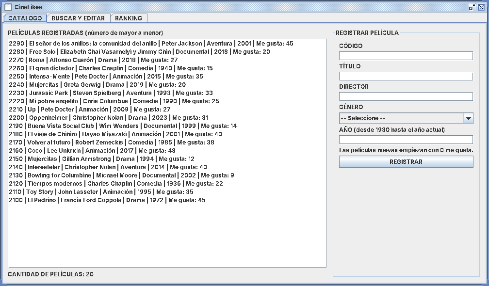
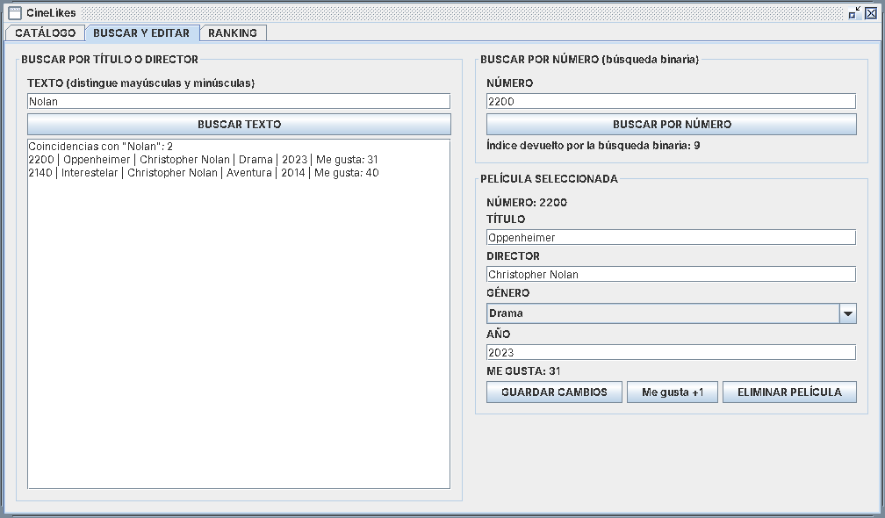
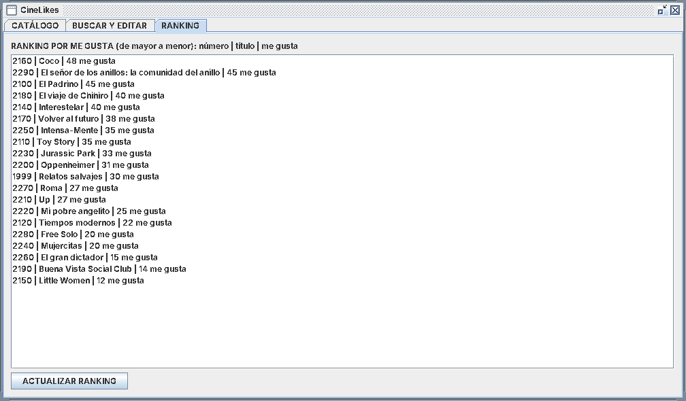

# Taller CineLikes

Hicimos una aplicación de escritorio en Java Swing para el catálogo de películas de un cineclub universitario. Con ella se pueden registrar películas, buscarlas por texto o por número, editarlas, eliminarlas, darles «Me gusta» y ver el ranking de popularidad.

- **Proyecto:** IntelliJ IDEA con JDK 25, sin Maven.
- **Interfaz:** la armamos con el plugin **Swing UI Designer** de IntelliJ (`Ventana.form` + `Ventana.java`).
- **Lo que usamos del curso:** `ArrayList`, ordenamiento por inserción, búsqueda lineal y búsqueda binaria propia.

## Cómo ejecutarlo

1. Clonen el repositorio con `git clone https://github.com/zaid290/CineLikes.git` y abran la carpeta en IntelliJ (**File > Open**).
2. Si IntelliJ muestra «Project JDK is not defined», pulsen **Setup SDK** y elijan el JDK 25.
3. En **Settings > Editor > GUI Designer** deben estar «Generate GUI into: Binary class files» y «Automatically copy form runtime classes to the output directory». Vienen así por defecto.
4. Ejecuten `Ventana` con la flecha verde junto a `main`.

## Cómo está organizado

| Archivo | Qué hace |
|---|---|
| `src/Pelicula.java` | Guarda los datos de una película. `numeroID` es `final`, así que no se edita, y `meGusta` solo sube con `darMeGusta()`. |
| `src/Lista.java` | Tiene toda la lógica y no usa Swing: el `ArrayList` principal, el ordenamiento, las dos búsquedas, las validaciones, editar, eliminar, me gusta y el ranking. |
| `src/DatosIniciales.java` | Trae las 20 películas iniciales, desordenadas a propósito para que se note el ordenamiento. |
| `src/Ventana.form` | Es el diseño de las 3 pestañas, hecho en el Swing UI Designer. |
| `src/Ventana.java` | Contiene solo los eventos de los botones (con lambdas). Cada uno llama a un método de `Lista` y muestra el resultado. |

## Cómo cumplimos cada requerimiento

| Req. | Dónde | Cómo |
|---|---|---|
| R1 | `Lista.cargarDatosIniciales()`, pestaña CATÁLOGO | Carga las 20 películas una sola vez gracias a la bandera `datosCargados`. No acepta números repetidos, pero sí géneros, años y me gusta repetidos. Muestra la cantidad actual. |
| R2 | `Lista.registrar(...)` | Valida todos los campos antes de agregar; si hay un error no agrega nada. Después ordena con inserción, porque el código nuevo puede ser menor que los que ya existen (por ejemplo, 1999). |
| R3 | `Lista.buscarPorTexto(...)` | Hace una búsqueda lineal con `contains` en el título **o** en el director, distinguiendo mayúsculas. Rechaza el texto vacío o con solo espacios. |
| R4 | `Lista.busquedaBinaria(...)`, `editar(...)`, `eliminar(...)` | La búsqueda binaria es propia y trabaja sobre la lista ordenada de mayor a menor. Devuelve el índice o `-1` y rechaza números no positivos. Para editar se valida todo antes de cambiar algo, y para eliminar se quita la película del `ArrayList`. |
| R5 | `Lista.darMeGusta(...)` | Cada clic suma exactamente 1 a la película seleccionada. Si no hay ninguna seleccionada, muestra un aviso. |
| R6 | `Lista.obtenerRanking()` | Devuelve una copia ordenada por me gusta (con inserción) que conserva los empates. Como la lista principal no cambia, la búsqueda binaria sigue funcionando. |

## Capturas de las tres pestañas

**CATÁLOGO:** listado, cantidad y registro.

**BUSCAR Y EDITAR:** búsqueda por texto, búsqueda binaria, edición, Me gusta +1 y eliminar.

**RANKING:** películas ordenadas por me gusta, de mayor a menor.

## Casos de comprobación

| # | Caso | Resultado | Evidencia |
|---|---|---|---|
| 1 | Abrir el programa | Aparecen 20 películas ordenadas por número de mayor a menor (2290 … 2100) y el contador dice «CANTIDAD DE PELÍCULAS: 20». | [captura](evidencias/01_pestana1_catalogo.png) |
| 2 | Registrar con el código 2160, que ya existe | Sale un error y no se agrega nada. | [captura](evidencias/02_registro_codigo_repetido.png) |
| 3 | Registrar con todos los campos vacíos | El mensaje lista los 5 errores juntos y no se agrega nada. | [captura](evidencias/03_registro_campos_vacios.png) |
| 4 | Registrar con el año 1929 (y también 2027) | Sale el error «El año debe estar entre 1930 y 2026». | [captura](evidencias/04_registro_anio_1929.png) |
| 5 | Registrar con el código 0 (y también -5) | Sale el error de código no positivo. | [captura](evidencias/05_registro_codigo_no_positivo.png) |
| 6 | Registrar el código 1999, menor que todos | La película se registra con 0 me gusta. | [captura](evidencias/06_registro_valido_1999.png) |
| 7 | Ver la lista después del registro | 1999 queda al final por el orden descendente y el total pasa a 21. | [captura](evidencias/07_lista_con_1999_al_final.png) |
| 8 | Buscar el texto «Nolan» | Salen 2 coincidencias por director: Oppenheimer e Interestelar. | [captura](evidencias/08_busqueda_texto_Nolan.png) |
| 9 | Buscar el texto «nolan» | Salen 0 coincidencias, porque se distinguen mayúsculas y minúsculas. | [captura](evidencias/09_busqueda_texto_nolan_minusculas.png) |
| 10 | Buscar un texto con solo espacios | Sale un aviso y no se busca nada. | [captura](evidencias/10_busqueda_texto_solo_espacios.png) |
| 11 | Buscar el número 1999 | La búsqueda binaria devuelve el índice 20 y se cargan los datos para editar. | [captura](evidencias/11_busqueda_numero_1999.png) |
| 12 | Buscar el número 9999 | Devuelve `-1`, sale el aviso «No existe…» y se limpia la selección anterior. | [captura](evidencias/12_busqueda_numero_inexistente.png) |
| 13 | Buscar el número 0 (y también -3 y «abc») | Se rechaza. | [captura](evidencias/13_busqueda_numero_no_positivo.png) |
| 14 | Pulsar Me gusta +1 sin película seleccionada | Sale un aviso y no cambia ningún contador. | [captura](evidencias/14_me_gusta_sin_seleccion.png) |
| 15 | Editar la 2240 con director vacío y año 1800 | Sale un error y no cambia **ningún** dato, ni siquiera el título que sí era válido. | [captura](evidencias/15_editar_invalido_sin_cambios.png) |
| 16 | Buscar «Mujercitas» y luego cambiar el título de la 2150 a «Little Women» | Se guarda, sale el aviso y los resultados se recalculan de 2 a 1. La pestaña 1 también se actualiza. | [aviso](evidencias/17_editar_valido_2150.png) · [resultados](evidencias/18_resultados_recalculados.png) |
| 17 | Pulsar Me gusta +1 treinta veces sobre la 1999 | La película llega a 30 me gusta y el ranking se actualiza. | [captura](evidencias/19_me_gusta_30_clics.png) |
| 18 | Eliminar la 2130 | Pide confirmación y la elimina del `ArrayList`. El total baja y al buscarla devuelve `-1`. | [confirmación](evidencias/20_eliminar_confirmacion.png) · [aviso](evidencias/21_eliminar_hecho.png) · [lista](evidencias/22_pestana1_despues_de_cambios.png) |
| 19 | Ver el ranking | Está ordenado por me gusta y conserva los empates (45-45, 40-40, 35-35…). Cambiar de pestaña o pulsar «ACTUALIZAR RANKING» varias veces no recarga ni duplica nada. | [captura](evidencias/23_pestana3_ranking.png) |
| 20 | Usar la búsqueda binaria después de ver el ranking | Sigue funcionando: 2290 devuelve el índice 0. | [captura](evidencias/24_binaria_despues_del_ranking.png) |

## Trabajo en equipo

| Integrante | Usuario GitHub | Mensaje de commit | Aporte | Commit |
|---|---|---|---|---|
| Zaid Chamorro | [zaid290](https://github.com/zaid290) | Logica de CineLikes: Pelicula, Lista (insercion, busqueda lineal y binaria) y 20 peliculas iniciales | Proyecto nuevo, modelo y toda la lógica (R1–R6) | [ver commit](https://github.com/zaid290/CineLikes/commit/da3ae90c316942bd7b6552545bbc011c87f1fef5) |
| Esteban Chapaca | [Esteban201020](https://github.com/Esteban201020) | Interfaz con Swing UI Designer: pestanas Catalogo (listado y registro) y Ranking | `Ventana.form` y `Ventana.java`: pestañas CATÁLOGO y RANKING | [ver commit](https://github.com/zaid290/CineLikes/commit/723749234f8060fc2087d200c7e14290cd3c2f16) |
| Mahe Paredes | [maheparedes](https://github.com/maheparedes) | Pestana Buscar y editar: busqueda por texto y binaria, editar, eliminar y Me gusta +1 | Pestaña BUSCAR Y EDITAR en `Ventana.form` y sus eventos en `Ventana.java` | [ver commit](https://github.com/zaid290/CineLikes/commit/daec2c2cca259e81bcbe57a9d072235ca1f802c6) |

Cada uno hizo su commit desde su propia cuenta y en este orden: lógica, pestañas 1 y 3, pestaña 2. Al final, Zaid subió este README con las evidencias.
